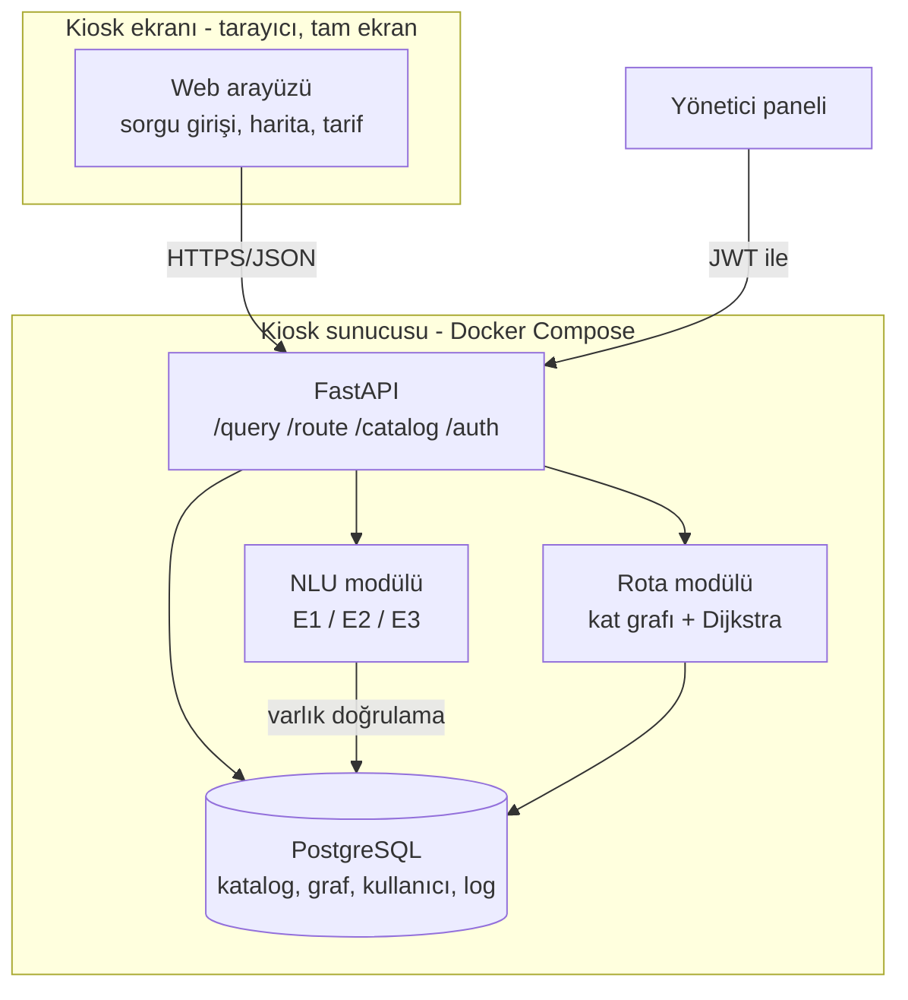

# Sistem Mimarisi

| Katman | Teknoloji | Görev |
|---|---|---|
| Arayüz | Web (tarayıcı) | Sorgu girişi, harita, adım adım tarif |
| API | FastAPI | İstek doğrulama, kimlik doğrulama, orkestrasyon |
| NLU | scikit-learn / Transformers | Niyet ve varlık çıkarımı |
| Rota | Python (Dijkstra) | Kat grafında en kısa yol |
| Veri | PostgreSQL | Katalog, graf, yönetici, anonim loglar |
| Dağıtım | Docker Compose | Tek komutla kurulum |

**Gizlilik:** Sorgu metni kişisel veri içermez; loglar anonim ve kapatılabilir (R9).
