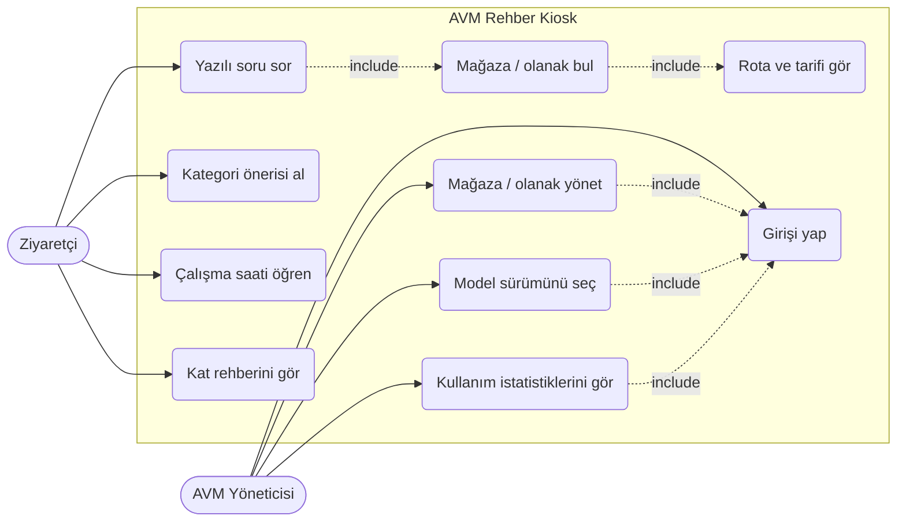

# Use Case Diyagramı

## Aktörler
- **Ziyaretçi:** Kiosk ekranından Türkçe cümle yazar; hesap gerekmez.
- **AVM yöneticisi:** Giriş yapar, mağaza/olanak kataloğunu günceller, kullanılacak modeli seçer.

## Ana senaryo (Ziyaretçi, mağaza bulma)
1. Ziyaretçi "kebap saryı nerede" yazar.
2. Sistem niyeti (`find_store`) ve mağazayı (Kebap Sarayı, 2. kat) çıkarır.
3. Kiosk konumundan mağazaya en kısa rotayı hesaplar.
4. Ekranda harita ve adım adım tarif gösterilir.
