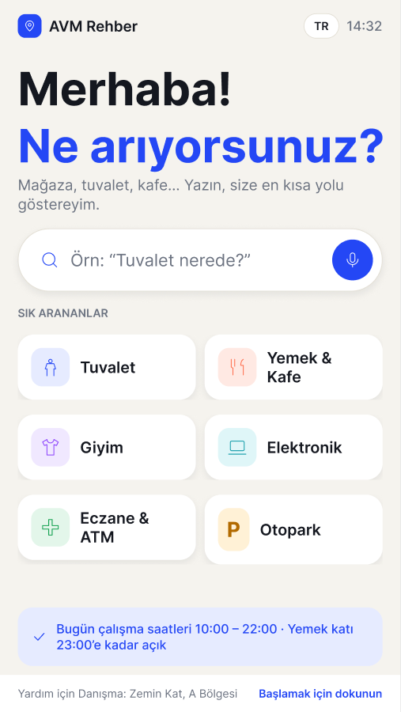
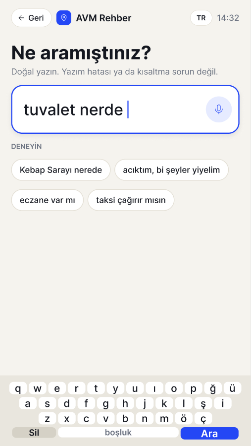
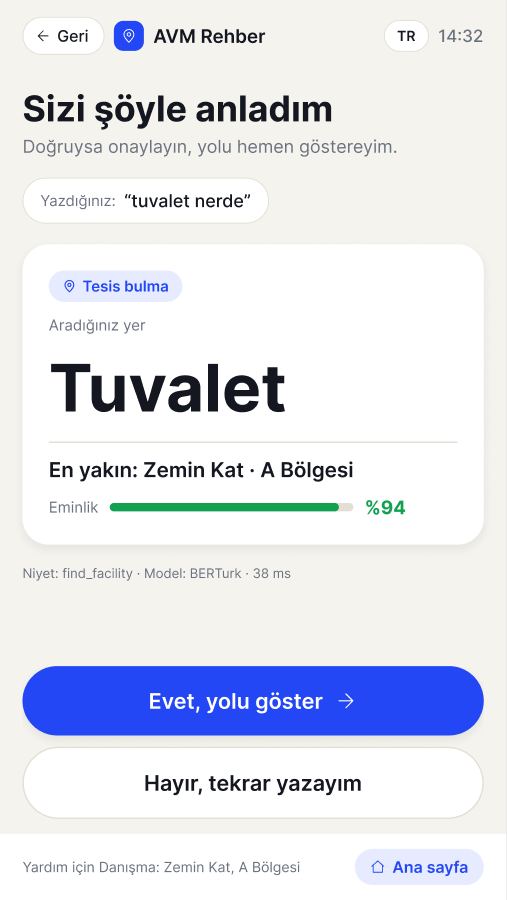
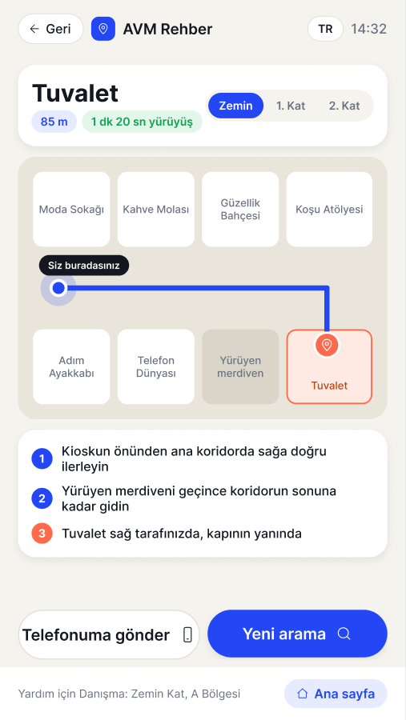
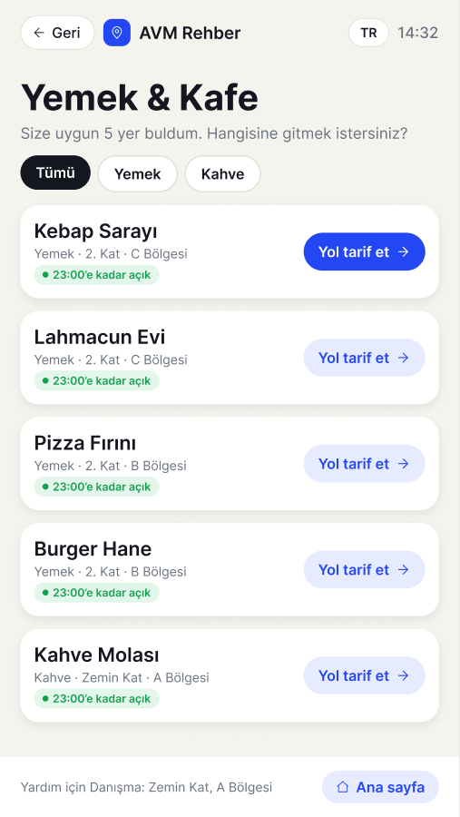
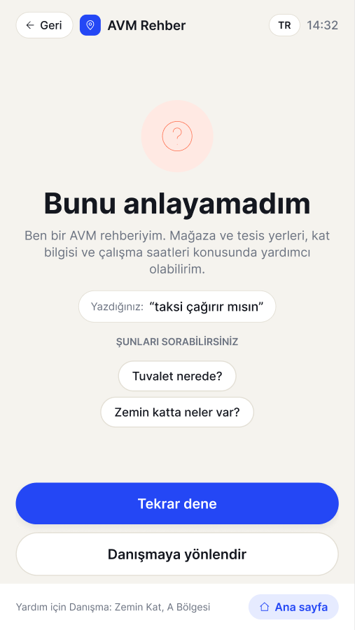

# Hafta 2 – Figma tıklanabilir prototip (AVM Kiosk Asistanı)

**Figma dosyası:** https://www.figma.com/design/SOANV5pMG98Y0GxCVBxn2y
(Sunum için: dosyayı aç → "Karşılama" çerçevesini seç → sağ üstte ▶ **Present**. Hocaların görebilmesi için dosyada *Share → Anyone with the link can view* ayarı yapılmalıdır.)

Kiosk dikey ekran (1080 × 1920 px) olarak tasarlandı; dokunmatik kullanım için büyük hedefler ve büyük yazı boyutları kullanıldı.

## Ekranlar ve akış

| # | Ekran | Amaç | Buradan nereye? |
|---|-------|------|-----------------|
| 1 | Karşılama | Arama çubuğu + sık aranan kategoriler | Arama → 2 · Tuvalet → 4 · diğer kategoriler → 5 |
| 2 | Sorgu | Doğal dilde yazma, ekran klavyesi, örnek sorgular | Ara → 3 · "taksi çağırır mısın" → 6 · "acıktım" → 5 |
| 3 | Anlaşıldı mı? | Modelin çıkardığı niyet + varlık + eminlik gösterilir, kullanıcı onaylar | Evet → 4 · Hayır → 2 |
| 4 | Rota | Kat planı üstünde en kısa yol, adım adım tarif | Yeni arama → 1 |
| 5 | Öneriler | Kategori sorgusunda (ör. yemek) mağaza listesi | Yol tarif et → 4 |
| 6 | Anlaşılamadı | Kapsam dışı / düşük güven için güvenli geri dönüş | Tekrar dene → 2 |

Ana akışlar:

- **Yer arama:** 1 → 2 → 3 → 4 (niyet: `find_facility` / `find_store`)
- **Öneri:** 1 → 5 → 4 (niyet: `recommend_category`)
- **Kapsam dışı:** 2 → 6 → 2 (niyet: `out_of_scope`)

## Tasarım kararları

- **Güven eşiği arayüzde görünür (Ekran 3):** Model emin değilse sonuç doğrudan gösterilmez, kullanıcıya "Sizi şöyle anladım" ile onaylatılır. Hafta 3'teki risk–kapsama analizinin ürün karşılığıdır.
- **Kapsam dışı için ayrı ekran (Ekran 6):** Mağaza dışı sorular (taksi, fıkra vb.) yanlış rota göstermez.
- **Renkler:** mavi (birincil), mercan (hedef/vurgu), yeşil (açık/başarılı), sıcak gri zemin. **Yazı tipi:** Inter.
- **Sayılar uydurma değildir ama örnektir:** mesafe, süre ve eminlik değerleri prototip içindir; gerçek değerler Hafta 6–7'de NLU ve rota servisinden gelecek.

## Önizleme

| 1 Karşılama | 2 Sorgu | 3 Anlaşıldı mı? |
|---|---|---|
|  |  |  |

| 4 Rota | 5 Öneriler | 6 Anlaşılamadı |
|---|---|---|
|  |  |  |
