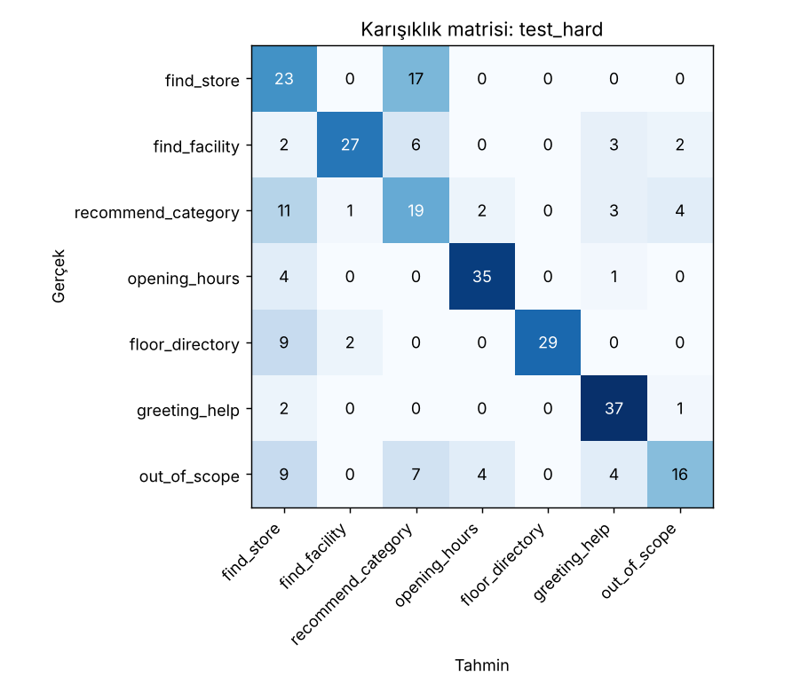

# Hafta 3: Baseline (E1) Raporu

Model: **TF-IDF (karakter 2-5 gram) + Lojistik Regresyon** (niyet) ve **sözlük + bulanık eşleştirme** (varlık).
Hiperparametre `C=1` doğrulama setinde seçildi; test setleri model seçiminde kullanılmadı.
Veri sentetiktir (bkz. `src/kiosk_nlu/generate_dataset.py`); gerçek kullanıcı sorguları eklenince zor test güncellenecek.

## Sonuçlar

| Metrik | test (dağılım içi) | test_hard | Hedef (öneri formu) | Durum (hard) |
|---|---|---|---|---|
| Niyet doğruluğu | 1.000 | 0.664 | - | - |
| Niyet makro-F1 (Q1) | 1.000 | 0.673 | ≥ 0.85 | ❌ |
| Varlık doğruluğu (Q2) | 0.974 | 0.601 | ≥ 0.85 | ❌ |
| Uçtan uca doğruluk (niyet+varlık) | 0.982 | 0.621 | - | - |
| Gecikme ort. (ms) | 2.12 | 3.09 | - | - |
| Gecikme p95 (ms), yalnızca NLU (Q3'ün parçası) | 5.25 | 7.12 | ≤ 500 | ✅ |

Referans: çoğunluk sınıfı tahmini test_hard üzerinde 0.143 doğruluk verir.

**Yorum:** Dağılım içi testte neredeyse mükemmel sonuç, şablon verisinde başarının doygunluğa ulaştığını gösterir; asıl ölçüt zor testtir. Q1 ve Q2 hedefleri E2 (BERTurk) ve E3 (küçük dil modeli) ile karşılanmaya çalışılacaktır.

## test_hard sınıf bazlı F1

| Niyet | Precision | Recall | F1 |
|---|---|---|---|
| find_store | 0.38 | 0.57 | 0.46 |
| find_facility | 0.90 | 0.68 | 0.77 |
| recommend_category | 0.39 | 0.47 | 0.43 |
| opening_hours | 0.85 | 0.88 | 0.86 |
| floor_directory | 1.00 | 0.72 | 0.84 |
| greeting_help | 0.77 | 0.93 | 0.84 |
| out_of_scope | 0.70 | 0.40 | 0.51 |

## Hata analizi (test_hard, ilk 12 hata)

| Metin | Gerçek | Tahmin | Gerçek varlık | Tahmin varlık |
|---|---|---|---|---|
| cocguma bir seyler bakacagim | recommend_category | out_of_scope | çocuk giyim | None |
| hocam sinema filmi oner evde izleerim | out_of_scope | recommend_category | nan | eğlence |
| acaba canım tatlı çekti | recommend_category | opening_hours | tatlı | None |
| acaba namaz kılma yri yerini gösterir misiniz | find_facility | recommend_category | mescit | None |
| kahve bakmak istiyorum bir fikrin var mı | recommend_category | find_store | kahve | None |
| pastane için iyi bir yer biliyor musun teşekkürler | recommend_category | greeting_help | tatlı | None |
| mrb | greeting_help | find_store | nan | None |
| ayakkabi numarasi nasli olculur? | out_of_scope | find_store | nan | None |
| bebegimi emzirmem gerekiyor | find_facility | find_facility | bebek bakım odası | None |
| tabanlık için yönlendirir misin | find_store | recommend_category | S09 | None |
| kalem kırtasiye mesi saatleri nelerdir! | opening_hours | find_store | S16 | S16 |
| acaba kayıp eşya için kime gideyim | find_facility | recommend_category | danışma | giyim |

Toplam hatalı örnek: 106 / 280 (tamamı: `results/errors_test_hard.csv`).
