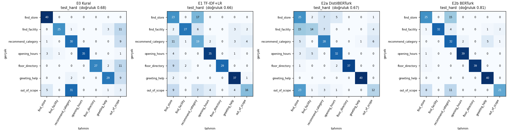
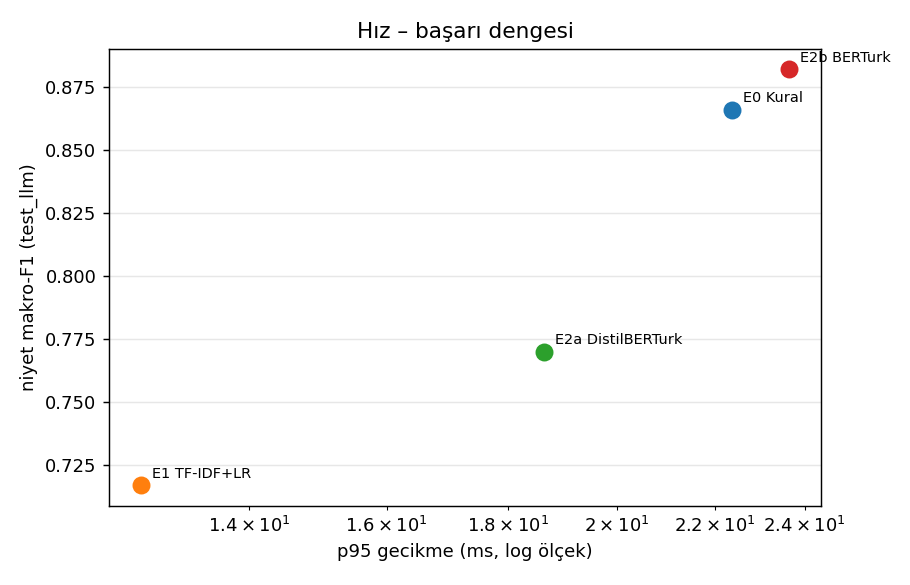

# Hafta 3: Model kıyaslaması (E0 / E1 / E2a / E2b)

> **Not (1. koşu):** Bu sonuçlar varlık başı 4 epoch eğitilerek alındı; varlık başı yakınsamadı (loss ≈2,3), bu yüzden E2a/E2b varlık doğruluğu düşüktür. Varlık başı için 15 epoch/lr 5e-5 düzeltmesi sonraki commit'te; 2. koşu sonuçları ayrıca eklenecek.

Colab'da çalıştırıldı: `notebooks/02_colab_week3.ipynb`. `test_llm` bir dil modeli tarafından yazılmıştır (gerçek kullanıcı verisi değildir).

## Özet

- **test**: en iyi niyet makro-F1 = E1 TF-IDF+LR (1.000, %95 GA [1.00, 1.00]); en iyi varlık doğruluğu = E1 TF-IDF+LR (0.974).
- **test_hard**: en iyi niyet makro-F1 = E2b BERTurk (0.816, %95 GA [0.77, 0.85]); en iyi varlık doğruluğu = E0 Kural (0.793).
- **test_llm**: en iyi niyet makro-F1 = E2b BERTurk (0.882, %95 GA [0.80, 0.94]); en iyi varlık doğruluğu = E0 Kural (0.908).
- **Genelleme açığı** (test − test_llm makro-F1): E0 Kural: +0.01, E1 TF-IDF+LR: +0.28, E2a DistilBERTurk: +0.17, E2b BERTurk: +0.11
- **Q1 hedefini (test_hard ≥ 0,85) karşılayan modeller:** henüz yok

## Sonuç tablosu

| Model             | Küme      |   n |   Niyet doğr. |   Makro-F1 | F1 %95 GA    |   Varlık doğr. |   Uçtan uca |   p95 ms |
|:------------------|:----------|----:|--------------:|-----------:|:-------------|---------------:|------------:|---------:|
| E0 Kural          | test      | 280 |         0.882 |      0.88  | [0.84, 0.92] |          0.948 |       0.882 |   21.805 |
| E0 Kural          | test_hard | 280 |         0.675 |      0.688 | [0.65, 0.73] |          0.793 |       0.675 |   26.326 |
| E0 Kural          | test_llm  |  97 |         0.887 |      0.866 | [0.75, 0.93] |          0.908 |       0.876 |   22.362 |
| E1 TF-IDF+LR      | test      | 280 |         1     |      1     | [1.00, 1.00] |          0.974 |       0.982 |   18.218 |
| E1 TF-IDF+LR      | test_hard | 280 |         0.664 |      0.673 | [0.62, 0.72] |          0.601 |       0.621 |   22.912 |
| E1 TF-IDF+LR      | test_llm  |  97 |         0.68  |      0.717 | [0.60, 0.79] |          0.671 |       0.639 |   12.613 |
| E2a DistilBERTurk | test      | 280 |         0.943 |      0.943 | [0.92, 0.97] |          0.165 |       0.414 |   12.186 |
| E2a DistilBERTurk | test_hard | 280 |         0.671 |      0.67  | [0.62, 0.71] |          0.17  |       0.336 |   12.819 |
| E2a DistilBERTurk | test_llm  |  97 |         0.732 |      0.77  | [0.67, 0.85] |          0.092 |       0.206 |   18.645 |
| E2b BERTurk       | test      | 280 |         0.989 |      0.989 | [0.98, 1.00] |          0.861 |       0.896 |   23.55  |
| E2b BERTurk       | test_hard | 280 |         0.814 |      0.816 | [0.77, 0.85] |          0.676 |       0.711 |   32.393 |
| E2b BERTurk       | test_llm  |  97 |         0.887 |      0.882 | [0.80, 0.94] |          0.618 |       0.619 |   23.641 |

## Hedefler (öneri formu)

| Küme      | Model             | Q1 makro-F1 (≥0,85)   | Q2 varlık (≥0,85)   | Q3 p95 ms (≤500)   |
|:----------|:------------------|:----------------------|:--------------------|:-------------------|
| test_hard | E0 Kural          | 0.688 ❌              | 0.793 ❌            | 26.3 ✅            |
| test_hard | E1 TF-IDF+LR      | 0.673 ❌              | 0.601 ❌            | 22.9 ✅            |
| test_hard | E2a DistilBERTurk | 0.670 ❌              | 0.170 ❌            | 12.8 ✅            |
| test_hard | E2b BERTurk       | 0.816 ❌              | 0.676 ❌            | 32.4 ✅            |
| test_llm  | E0 Kural          | 0.866 ✅              | 0.908 ✅            | 22.4 ✅            |
| test_llm  | E1 TF-IDF+LR      | 0.717 ❌              | 0.671 ❌            | 12.6 ✅            |
| test_llm  | E2a DistilBERTurk | 0.770 ❌              | 0.092 ❌            | 18.6 ✅            |
| test_llm  | E2b BERTurk       | 0.882 ✅              | 0.618 ❌            | 23.6 ✅            |

## Boyut, hız, başarı

|                   |   Parametre (M) |   Eğitim (sn) |   p95 gecikme (ms) |   Makro-F1 test_hard |   Makro-F1 test_llm |
|:------------------|----------------:|--------------:|-------------------:|---------------------:|--------------------:|
| E0 Kural          |           0     |         0     |             22.362 |                0.688 |               0.866 |
| E1 TF-IDF+LR      |           0.03  |         9.223 |             12.613 |                0.673 |               0.717 |
| E2a DistilBERTurk |         136.233 |        57.075 |             18.645 |                0.67  |               0.77  |
| E2b BERTurk       |         221.29  |       104.735 |             23.641 |                0.816 |               0.882 |

## Grafikler

