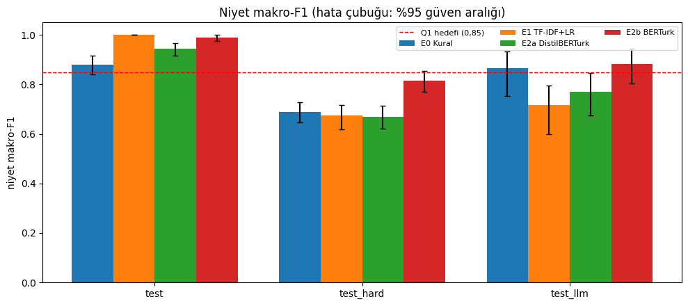
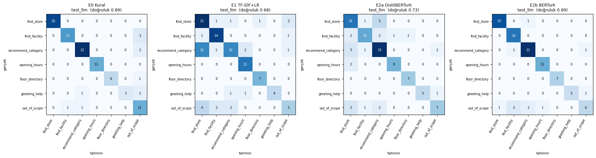
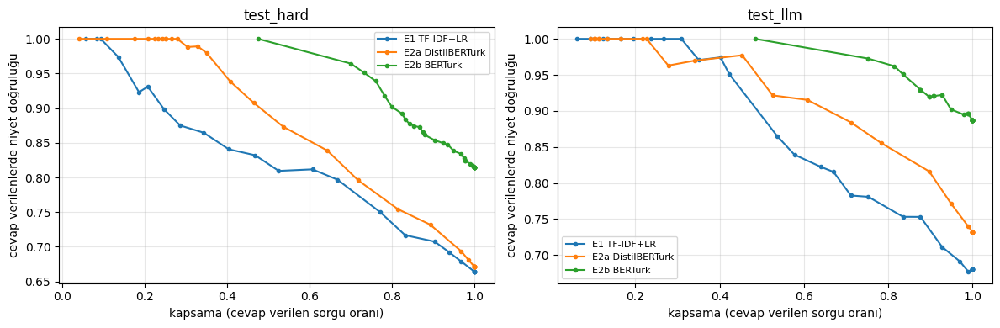
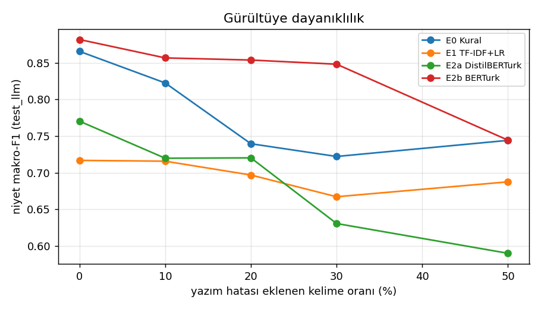

# Hafta 3: Model kıyaslaması (E0 / E1 / E2a / E2b)

Colab'da (T4 GPU) çalıştırıldı: `notebooks/02_colab_week3.ipynb` (çıktılarıyla birlikte kayıtlı).
`test_llm` bir dil modeli tarafından yazılmıştır, **gerçek kullanıcı verisi değildir**. E0 kural modeli bu cümleler görüldükten sonra yazıldığı için E0'ın `test_llm` skoru iyimserdir; `test_hard` daha dürüst bir ölçümdür.

## 2. koşu: varlık başı düzeltmesi

1. koşuda varlık başı 4 epoch eğitilmişti ve yakınsamadı (loss ≈ 2,3). 2. koşuda varlık başı 15 epoch ve lr 5e-5 ile eğitildi (loss E2b'de 0,03'e, E2a'da 0,22'ye indi). Niyet başı değişmedi.

| Model | test_hard varlık (1. koşu → 2. koşu) | test_llm varlık (1. koşu → 2. koşu) |
|---|---|---|
| E2a DistilBERTurk | 0,170 → 0,660 | 0,092 → 0,711 |
| E2b BERTurk | 0,676 → 0,809 | 0,618 → 0,934 |

## Sonuç tablosu

| Model | Küme | n | Niyet doğr. | Makro-F1 | F1 %95 GA | Varlık doğr. | Uçtan uca | p95 ms |
|---|---|---|---|---|---|---|---|---|
| E0 Kural | test | 280 | 0,882 | 0,880 | [0,84, 0,92] | 0,948 | 0,882 | 20,4 |
| E0 Kural | test_hard | 280 | 0,675 | 0,688 | [0,65, 0,73] | 0,793 | 0,675 | 28,3 |
| E0 Kural | test_llm | 97 | 0,887 | 0,866 | [0,75, 0,93] | 0,908 | 0,876 | 37,8 |
| E1 TF-IDF+LR | test | 280 | 1,000 | 1,000 | [1,00, 1,00] | 0,974 | 0,982 | 11,6 |
| E1 TF-IDF+LR | test_hard | 280 | 0,664 | 0,673 | [0,62, 0,72] | 0,601 | 0,621 | 14,2 |
| E1 TF-IDF+LR | test_llm | 97 | 0,680 | 0,717 | [0,60, 0,79] | 0,671 | 0,639 | 11,3 |
| E2a DistilBERTurk | test | 280 | 0,943 | 0,943 | [0,92, 0,97] | 0,907 | 0,929 | 11,4 |
| E2a DistilBERTurk | test_hard | 280 | 0,671 | 0,670 | [0,62, 0,71] | 0,660 | 0,643 | 17,5 |
| E2a DistilBERTurk | test_llm | 97 | 0,732 | 0,770 | [0,67, 0,85] | 0,711 | 0,680 | 15,4 |
| E2b BERTurk | test | 280 | 0,989 | 0,989 | [0,98, 1,00] | 0,995 | 0,989 | 22,7 |
| E2b BERTurk | test_hard | 280 | 0,814 | 0,816 | [0,77, 0,85] | 0,809 | 0,800 | 30,3 |
| E2b BERTurk | test_llm | 97 | 0,887 | 0,882 | [0,80, 0,94] | 0,934 | 0,866 | 21,1 |

## Hedefler (öneri formu)

| Küme | Model | Q1 makro-F1 (≥0,85) | Q2 varlık (≥0,85) | Q3 p95 ms (≤500) |
|---|---|---|---|---|
| test_hard | E0 Kural | 0,688 ❌ | 0,793 ❌ | 28,3 ✅ |
| test_hard | E1 TF-IDF+LR | 0,673 ❌ | 0,601 ❌ | 14,2 ✅ |
| test_hard | E2a DistilBERTurk | 0,670 ❌ | 0,660 ❌ | 17,5 ✅ |
| test_hard | E2b BERTurk | 0,816 ❌ | 0,809 ❌ | 30,3 ✅ |
| test_llm | E0 Kural | 0,866 ✅ | 0,908 ✅ | 37,8 ✅ |
| test_llm | E1 TF-IDF+LR | 0,717 ❌ | 0,671 ❌ | 11,3 ✅ |
| test_llm | E2a DistilBERTurk | 0,770 ❌ | 0,711 ❌ | 15,4 ✅ |
| test_llm | E2b BERTurk | 0,882 ✅ | 0,934 ✅ | 21,1 ✅ |

## Boyut, hız, başarı

| Model | Parametre (M, iki baş toplamı) | Eğitim (sn) | p95 ms (test_llm) | Makro-F1 test_hard | Makro-F1 test_llm |
|---|---|---|---|---|---|
| E0 Kural | 0 | 0 | 37,8 | 0,688 | 0,866 |
| E1 TF-IDF+LR | 0,03 | 5,5 | 11,3 | 0,673 | 0,717 |
| E2a DistilBERTurk | 136 | 106 | 15,4 | 0,670 | 0,770 |
| E2b BERTurk | 221 | 207 | 21,1 | 0,816 | 0,882 |

## Özet

- E2b (BERTurk) her zor kümede en iyi: `test_hard` makro-F1 0,816 (GA 0,77–0,85, Q1 hedefi 0,85'in hemen altı), varlık 0,809; `test_llm` makro-F1 0,882, varlık 0,934.
- Genelleme açığı (test − test_llm makro-F1): E0 +0,01, E1 +0,28, E2a +0,17, E2b +0,11. E1 şablona ezber yapıyor, BERT daha iyi genelliyor.
- `test_hard` zor sette Q1 ve Q2 hedefleri henüz hiçbir modelde tutmuyor. Q3 (gecikme) tüm modellerde rahatça sağlanıyor.
- E2a (DistilBERTurk) niyette E1'e yakın, varlıkta E1'den iyi ama E2b'nin gerisinde.
- Güven aralıkları geniş (test_llm n=97); küçük farklar tesadüf olabilir.

## Grafikler

